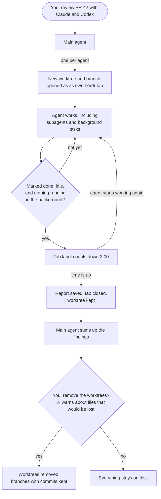

# herdr-worktree-agents

**Every agent gets its own paddock.** This skill gives each coding agent its own git worktree and its own [herdr](https://github.com/herdrdev/herdr) workspace and tab. When the agent's work is truly done, its tab closes on its own, and your main agent asks you before deleting any worktrees.

It's an agent skill for herdr, the terminal multiplexer for coding agents. If you've used Orca's worker flow, where Claude or Codex runs in its own worktree and reports back, this is the same idea for herdr. Like Orca's Orchestrator V3, it closes each worker's tab two minutes after the worker finishes, which frees the terminal and keeps your workspace tidy.

Ask your agent for something like "review PR 42 with Claude and Codex." For each agent, the skill:

1. creates its own git worktree on its own branch,
2. opens that worktree as its own herdr workspace and tab, named after the agent,
3. starts the agent there and sends it the task,
4. watches it, and closes the tab 2 minutes after the agent's whole chain of work is finished, including any subagents and background tasks,
5. at the end, asks you whether to remove the worktrees it created.

Agents never share files with each other or with your checkout. Nothing on disk is deleted without your yes.



## Install

```bash
npx skills add herdrdev/herdr                 # the herdr skill this one builds on
npx skills add neo-anderson/herdr-worktree-agents
```

The skill applies only when your agent is running inside a herdr pane (`HERDR_ENV=1`). Once installed, it becomes the default way your agent starts other agents through herdr, replacing the herdr skill's split-pane default.

### Requirements

- herdr 0.9.5 or later (tested on 0.9.5, protocol 22)
- Python 3.8+ (3.11+ to read the config file)
- git 2.31 or later
- `jq`, used only by the skill's suggested wait loop
- macOS or Linux. Tested on macOS. Windows is not supported.

## YOLO mode (recommended)

Agents started with their normal approval prompts will often stop and wait for you to approve a command. That happens in a tab you aren't looking at, so work stalls until you notice the notification and switch over.

**Turning on YOLO mode makes the whole flow much smoother.** Agents then run start to finish without stopping, and their tabs close as soon as they're done. To turn it on for every run:

```toml
# ~/.config/herdr-worktree-agents/config.toml
yolo = true
```

You can also ask for it on a single run, and the skill passes `--yolo`. `--no-yolo` overrides the config for one run.

With YOLO on:

- Codex starts with `--dangerously-bypass-approvals-and-sandbox`, so it has no approval prompts and no sandbox.
- Claude starts with `--dangerously-skip-permissions`.

The trade-off is real. Nothing stops an agent from pushing, commenting on GitHub, or deleting files, except what its task tells it. Each agent works in its own worktree, which limits accidents to its own copy of the repo. It does not limit network access or commands that reach outside the repo. Use YOLO only on repos and tasks you trust.

The first time Claude starts in this mode, it shows a one-time warning. The skill stops and asks you to accept it, so it only interrupts once.

## How it knows an agent is finished

An agent's status alone isn't enough. herdr can show an agent as idle while a background task or subagent it started is still running. The watcher waits until all three of these are true:

1. **The agent marked itself done.** Its prompt includes a short contract: write the final report, then create a "done" file, but only after every subagent and background task has finished.
2. **herdr shows the agent as idle or done.**
3. **No command shells are running under the agent.** These are processes such as `zsh -c ...` or `bash -lc ...`, which is how Claude Code and Codex run commands, including background ones. Shells that existed before the task started don't count.

Once all three hold, the tab name shows a countdown (`claude-review · closing 1:45`) and herdr shows a notification. If anything changes, for example the agent starts working again, the countdown resets.

## What happens when an agent finishes

When the countdown ends, the watcher:

- copies the report to `~/.local/state/herdr-agents/runs/<run>/<name>.md`,
- closes the agent's herdr workspace and tab, which ends its terminal session,
- keeps the worktree and branch on disk, including any uncommitted changes,
- notifies you.

If the agent exits without marking itself done, or 12 hours pass without the work finishing, the tab stays open and you get a notification.

## Removing worktrees: always your call

Once the agents are done, your main agent lists what's left and asks whether to remove it. For each worktree, it shows the path, the branch, and any new commits.

**If removing a worktree would delete anything, you get a warning first.** The agent shows a highlighted callout listing those files, labeled as code, plans, docs, artifacts, or config. That covers uncommitted files, and also files git ignores, such as a generated `report.html` in a git-ignored `out/` folder. Git deletes ignored files during `worktree remove` without asking, so the skill treats them as at risk. Caches and dependency folders like `node_modules` and `.venv` don't count.

> ⚠️ **`codex-review` has 3 files that removal would delete**
> - `docs/migration-plan.md`: plan, uncommitted
> - `src/retry.py`: code, uncommitted
> - `out/report.html`: artifact, ignored by git

Nothing is removed until you say yes. Even then, the cleanup script:

- skips any worktree whose tab is still open,
- skips worktrees with files at risk, unless you explicitly agreed to lose them,
- deletes a branch only if it has no new commits. Branches with commits are always kept.

You can also run it yourself at any time:

```bash
python3 <skill-dir>/scripts/cleanup.py --run <run>            # list, with warnings in color
python3 <skill-dir>/scripts/cleanup.py --run <run> --remove   # remove the ones with nothing at risk
```

## What it changes on your machine

- **Worktrees** under `~/.herdr/worktrees/<repo>/`, managed by herdr. To put them somewhere else, set `worktree_root = "/path"` in `~/.config/herdr-worktree-agents/config.toml`, or the `HWA_WORKTREE_ROOT` environment variable. Worktrees then go in `<root>/<repo>/<branch>`.
- **Branches** named `herdr/<run>-<name>` in your repo. When you approve cleanup, branches without new commits are deleted.
- **One line, `/.herdr-agent/`, in each repo's `.git/info/exclude`**, so the agent's report and done files never show up in `git status` or get committed. This file is local to your clone and is never pushed.
- **State and logs** in `~/.local/state/herdr-agents/runs/` (or `$XDG_STATE_HOME`).
- **A workspace for your main checkout.** When the first worktree of a repo is created, herdr opens a workspace for the main checkout too, if one isn't open already. The skill leaves it alone.
- **Folder trust.** The first time Claude or Codex opens a worktree of a repo it hasn't trusted, it asks whether to trust the folder. The skill stops and asks you. Both tools save trust at the main repo root, so this happens once per repo.

## Limits

- **Subagent tracking relies on the agent keeping its promise.** Background shell commands are detected directly. In-process subagents are not visible from outside, so the watcher depends on the agent creating the done file only when they're finished. If an agent never creates the file, its tab stays open.
- **The background-task check depends on how agents run commands today.** If Claude Code or Codex stop running commands as shell child processes, that check would miss them. The done file still keeps the tab from closing early in that case.
- **`--pr` is GitHub-only.** It fetches `pull/<n>/head` from a remote (default `origin`; change it with `--remote`). On other hosts, pass `--base <ref>` instead.

## Checking on a run

```bash
jq .state ~/.local/state/herdr-agents/runs/<run>/<name>.json   # running, tab_closed, worktree_removed, ...
cat ~/.local/state/herdr-agents/runs/<run>/<name>.log
```

To keep a tab open, kill its watcher (`watcher_pid` in the same JSON file).

## License

MIT. See [LICENSE](LICENSE).
